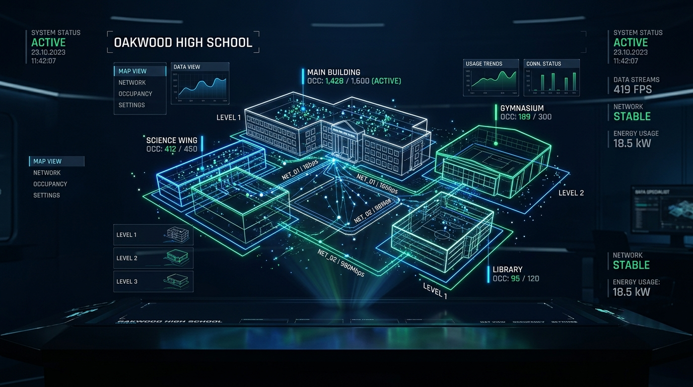
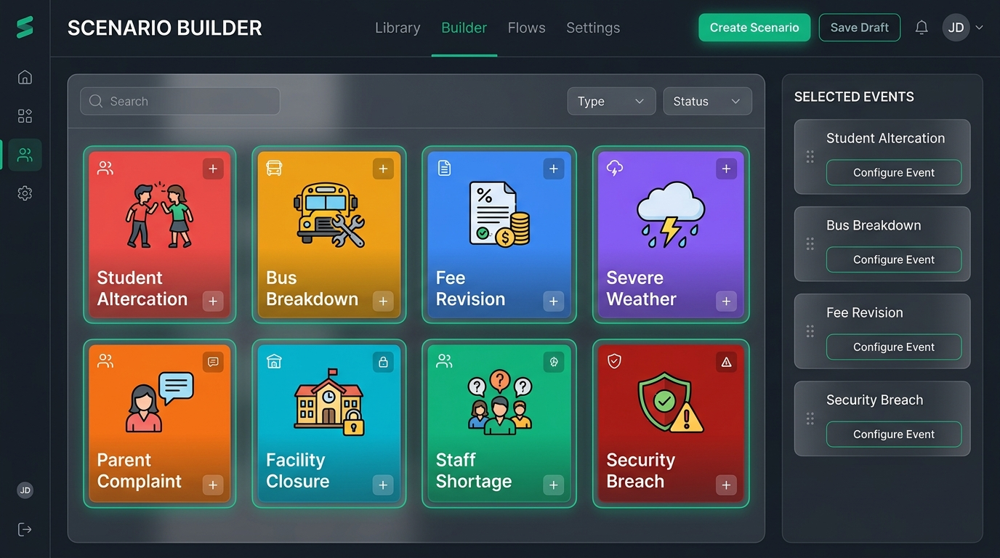
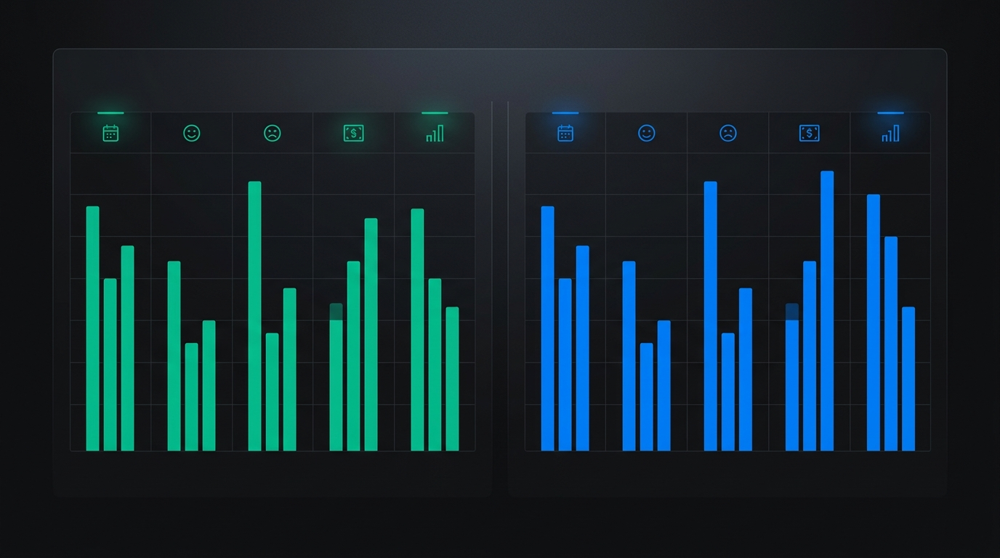

<div align="center">


# 🏫 SchoolTwin
### High-Fidelity Synthetic Digital Twin of a Delhi Secondary School

*A deterministic, multi-agent operational simulation and what-if scenario exploration platform for campus administration, student wellbeing, transport logistics, and facility planning.*

[](https://www.python.org/)
[](http://localhost:8765)
[](https://github.com)
[](https://github.com)
[](https://github.com)

<p align="center">
  <a href="#-quickstart"><strong>Quickstart</strong></a> •
  <a href="#-core-capabilities"><strong>Core Capabilities</strong></a> •
  <a href="#-scenario-builder--branching"><strong>Scenario Builder</strong></a> •
  <a href="#-honest-scenario-comparison"><strong>Comparison Engine</strong></a> •
  <a href="#-performance-benchmark"><strong>Benchmark</strong></a> •
  <a href="#-testing"><strong>Tests</strong></a>
</p>

</div>

---

> [!IMPORTANT]
> **SYNTHETIC DIGITAL TWIN NOTICE**  
> SchoolTwin models a fictional secondary school in Delhi across 151 days (January – May 2026). All student profiles, teacher rosters, operational logs, and camera counts are **100% computationally generated**. Outcomes represent exploratory scenarios and policy what-ifs, not real-world predictions. **Facial recognition, individual biometric tracking, and person-level surveillance are architecturally banned**; sensing is restricted strictly to aggregate zone occupancy counters.

---

## ⚡ Campus at a Glance

| 👥 1,309 | 📅 151 Days | 📍 69 Zones | ⚡ 10.98s |
| :---: | :---: | :---: | :---: |
| **Synthetic Agents**<br><sub>1,020 Students & 123 Staff</sub> | **Full School Term**<br><sub>January – May 2026</sub> | **Monitored Campus Locations**<br><sub>Classrooms, Labs, Grounds</sub> | **90-Day Simulation**<br><sub>High-performance PRNG engine</sub> |

---

## 🎯 What is SchoolTwin?

SchoolTwin provides school principals, administrators, and policy planners with an interactive sandbox to test decisions **before deploying them in reality**. By simulating the interlinked dynamics of academics, staffing, transport, student sentiment, and facility load, SchoolTwin reveals second-order consequences of policy choices.

<div align="center">
  
  <p><em>Real-time 2D spatial canvas monitoring 69 campus zones, aggregate footfall streams, and agent mood dynamics.</em></p>
</div>

### Key Capabilities

- **Instant Term Playback:** Load and scrub through a pre-computed 151-day synthetic term (`pack/story_baseline`) with zero generation lag.
- **Minute-by-Minute & Time-Lapse Modes:** Observe morning arrivals, classroom rotations, lunch rushes, bus departures, and after-school events in real time or accelerated playback.
- **Immutable Checkpoint Branching:** Branch alternative futures off any validated milestone (Term Start, Month-End, Pre-Exam, Heat Wave) without altering baseline records.
- **Causal Consequence Engine:** Deterministic rule-based event propagation linking incidents, learning degradation, substitute coverage, and double-entry school accounting.
- **Three-Level Agent Architecture:** 1,309 persistent individual cognitive states, sparse relationship networks, and bounded epistemic memory across students and staff.
- **AI Principal with 4-Tier Authorization:** Evidence-based executive policy recommendations with human approval gates for high-impact actions.
- **Optional Local LLM Reasoning:** Deep reasoning via local Ollama (`qwen3.5:4b`) with circuit breaker, instant rule-based fallback, and SHA-256 replay traces.
- **Honest Metric Delta Comparison:** Contrast scenario runs against the baseline with explicit computational status badges (`Computed`, `Configured`, `Not modeled`, `Unavailable`).

---

## 🚀 Quickstart

SchoolTwin requires **no paid APIs, no external cloud connections, and runs completely locally**.

### 1. Clone & Install Dependencies
```bash
git clone https://github.com/RohitOPBoi/schooltwin.git
cd schooltwin
pip install -r requirements.txt
```

### 2. Launch Local Server
```bash
python scripts/serve.py
```

### 3. Open in Browser
Visit **[http://localhost:8765](http://localhost:8765)** for the live interactive simulator, or **[http://localhost:8765/docs/](http://localhost:8765/docs/)** for visual interactive documentation.

```text
┌────────────────────────────────────────────────────────┐
│  SchoolTwin Operations Control                         │
│  ├── [Option A] Replay Baseline: Jan–May 2026 Term     │
│  └── [Option B] Create Scenario: Fork & Run What-If    │
└────────────────────────────────────────────────────────┘
```

---

## 🛠️ Scenario Builder & Branching

Create distinct hypothetical timelines by applying events and policy levers starting from any immutable milestone:

<div align="center">
  
</div>

### Milestone Checkpoints

| Checkpoint Identifier | Day | Context & Initial Conditions |
|---|:---:|---|
| `CKPT-DAY-00-OPENING` | **Day 0** | Opening day of the academic term |
| `CKPT-DAY-30-JAN-CLOSE` | **Day 30** | Post-Republic Day; attendance patterns stabilize |
| `CKPT-DAY-60-FEB-CLOSE` | **Day 60** | Pre-Annual Day rehearsals & staff workload peak |
| `CKPT-DAY-90-APRIL-PROMOTIONS` | **Day 90** | New academic session transition (3-month horizon) |
| `CKPT-DAY-120-MAY-HEAT` | **Day 120** | Delhi summer heat conditions; outdoor restrictions |
| `CKPT-DAY-150-TERM-CLOSE` | **Day 150** | Final examinations and term conclusion |

### Supported Event Types

<details open>
<summary><strong>Explore Event Injectors</strong></summary>

- 🥊 **`serious_student_fight`**: Physical altercation involving 3 students. Dispatches staff monitors, routes students to the infirmary, and triggers parent notifications.
- 🔍 **`suspected_prohibited_business`**: Presumed-innocent administrative review into unapproved on-campus trading.
- 🚌 **`bus_breakdown`**: Mechanical failure on a designated route. Generates late-arrival cascades and driver dispatch logs.
- 📈 **`school_fee_increase`**: Tuition and transport fee updates (+/-20%) with modeled parent inquiry volume and collection friction.
- 📝 **`teacher_resignation_notice`**: Faculty departure creating substitute cover demand and classroom disruption.
- 🤝 **`additional_teacher_hired`**: Mid-term recruitment mitigating lesson substitution stress and workload.

</details>

### Policy Levers

Adjust organizational levers within validated bounds:
- **Faculty Recruitment:** `0 to 10 additional teachers`
- **Fee Restructuring:** `-10% to +20% tuition/transport delta`
- **Attendance Welfare Budget:** `₹0 to ₹300,000 / month`
- **Standby Transport Reserve:** `0 to 4 backup buses`
- **Campus Facility Maintenance:** `₹0 to ₹2,000,000 capital fund`

---

## 🧠 Three-Level Agent Architecture & Cognitive Simulation (Phase 4)

SchoolTwin introduces a lightweight, computationally bounded cognitive architecture across all 1,309 synthetic individuals (1,020 students, 122 staff, teachers, and school leadership) without turning the simulation into an unconstrained, expensive collection of LLM calls.

```text
┌────────────────────────────────────────────────────────────────────────┐
│                        THREE-LEVEL AGENT SYSTEM                        │
├────────────────────────────────────────────────────────────────────────┤
│ Level 1: Persistent Population State (1,309 agents)                    │
│   ├── Vectorized attributes: engagement, confidence, mood, stress      │
│   ├── Bounded Epistemic Memory (FIFO eviction, fact vs hearsay)        │
│   └── Sparse Relationship Graph (classmates, close peers, coworkers)   │
├────────────────────────────────────────────────────────────────────────┤
│ Level 2: Lightweight Behavior Agents & Action Catalog                  │
│   ├── Strict ActionValidator with role, parameter & precondition checks│
│   └── Deterministic RuleBasedReasoner for fast offline execution       │
├────────────────────────────────────────────────────────────────────────┤
│ Level 3: Selective Local AI Reasoning (Optional Ollama)                │
│   ├── AI Principal Agent with 4-Tier Authorization Workflow            │
│   ├── Local Ollama (`qwen3.5:4b`) with circuit breaker (3-strike)      │
│   └── Bit-for-bit replayable decision trace with SHA-256 prompt hashes │
└────────────────────────────────────────────────────────────────────────┘
```

### 1. Level 1: Lightweight Individual State & Bounded Memory

Every student and teacher maintains an individual, persistent cognitive profile stored canonically alongside simulation state:

| Cognitive Variable | Range | Dynamics & Rules |
|---|:---:|---|
| **`engagement`** | `0.0 – 1.0` | Boosted by remedial interventions and peer support; drops during teacher absences |
| **`academic_confidence`**| `0.0 – 1.0` | Directly coupled to subject mastery; decays without targeted instruction |
| **`mood_proxy`** | `1.0 – 10.0` | Synthetic emotional state; drops on disciplinary encounters, recovers at 5%/day |
| **`stress_proxy`** | `0.0 – 1.0` | Elevated by exam density, heat wave conditions, or classroom disruptions |
| **`attendance_tendency`**| `0.0 – 1.0` | Dictates probability of morning arrival; sensitive to transport disruptions |
| **`active_objective`** | String / None | Current goal (e.g., `"improve_mastery"`, `"cooperate_inquiry"`) |

#### Bounded Epistemic Memory
Agents form individual memories from campus events, categorizing knowledge by epistemic confidence:
- **`CONFIRMED_FACT`** (Importance `0.92`): Direct participants in verified incidents.
- **`EYEWITNESS_ACCOUNT`** (Importance `0.65`): Observers physically present in the incident zone.
- **`UNSUBSTANTIATED_HEARSAY`** (Importance `0.35`): Peers who heard reports through social graphs. **Rumors never automatically convert into confirmed facts.**
- **`ADMINISTRATIVE_NOTICE`** (Importance `0.80`): Official school circulations and policy announcements.
- **Retention:** Bounded buffer (max 10 entries per agent). FIFO eviction strictly preserves high-importance memories (`importance >= 0.8`).

#### Sparse Relationship Graph
Relationships are modeled as a sparse adjacency graph ($O(K \times N)$ where $K \le 8$):
- **Classmates:** Co-enrolled students within the same classroom section.
- **Close Friends:** High-affinity peer cliques (`strength: 0.85`).
- **Teacher-Student:** Academic mentorship and supervisory connections.
- **Coworkers:** Departmental and administrative staff collaboration links.
- *Dense $O(N^2)$ graphs are architecturally banned to preserve sub-second updates.*

---

### 2. Level 2: Behavior Agents & Supported Action Catalog

Agents propose actions evaluated against strict preconditions by the simulation's `ActionValidator`. Unsupported, unauthorized, or malformed proposals are rejected safely:

| Role | Supported Action | Precondition & Effect |
|---|---|---|
| **Student** | `seek_academic_help` | `academic_confidence < 0.65`. Triggers peer or teacher study session. |
| **Student** | `cooperate_with_investigation`| Active disciplinary inquiry. Provides eyewitness testimony. |
| **Student** | `participate_in_remedial` | Low subject mastery. Boosts engagement and learning progress. |
| **Student** | `decline_peer_conflict` | Confrontation event in zone. Lowers personal stress and prevents fight escalation. |
| **Teacher** | `provide_remedial_instruction`| Student requests support. Increases subject mastery for target section. |
| **Teacher** | `request_classroom_support` | Class disturbance or staff shortage. Reassigns available monitor. |
| **Teacher** | `report_campus_hazard` | Faulty infrastructure detected. Dispatches maintenance task. |
| **Staff** | `dispatch_bus_backup` | Route breakdown alert. Activates standby bus and notifies parents. |

---

### 3. Level 3: AI Principal & Local Ollama Reasoning

The AI Principal evaluates operational conditions, incidents, finances, and academic metrics to formulate structured recommendations.

#### 4-Tier Authorization Workflow
1. **`INFORMATIONAL`**: Low-risk queries and diagnostic summaries. Auto-approved.
2. **`LOW_IMPACT`**: Routine operational adjustments (maintenance dispatches, minor timetable swaps). Auto-approved within budget limits.
3. **`HIGH_IMPACT`**: Consequential actions (staff termination, fee restructuring, formal inquiries). **Gated by explicit human approval**. Stored in pending state until authorized.
4. **`PROHIBITED`**: Actions outside school policy, unauthorized budgets, or invalid parameters. Rejected immediately.

#### Offline-First Local LLM Integration
- **Engine:** Connects to local Ollama (`qwen3.5:4b` default) over localhost HTTP (`127.0.0.1:11434`).
- **Zero API Keys & Zero Telemetry:** Operates 100% locally with zero external network dependencies.
- **Circuit Breaker:** 2.5-second request timeout; 3 consecutive timeouts trigger a circuit breaker that routes all subsequent requests to the deterministic `RuleBasedReasoner`.
- **Bit-for-Bit Decision Replay:** Every accepted LLM decision is saved with a canonical SHA-256 prompt hash (`trace_hash`). Replaying an existing run uses saved decision traces without invoking model inference again.

---

## ⚖️ Causal Simulation & Consequence Propagation (Phase 3)

SchoolTwin replaces static lookups with a deterministic, rule-based causal propagation network:

- **Incident Ripple Network:** A classroom altercation doesn't just log an event; it affects participant stress, dispatches teacher monitors, routes students to the infirmary, and triggers camera occupancy spikes.
- **Academic Progression & Timetable Cover:** Teacher absences cause unattended periods, accelerating learning degradation and student disengagement unless mitigated by substitute assignments.
- **Double-Entry Financial Accounting:** Tracks revenue inflows (tuition and transport collections) against operational debits (staff payroll, facility maintenance, emergency bus repairs) in an auditable double-entry ledger.
- **Fleet Logistics & Facility Deterioration:** Models summer heat wear on cooling systems, emergency reserve bus dispatching, and preventative maintenance queues.

---

## 📊 Honest Scenario Comparison

SchoolTwin features a rigorous comparison engine that highlights differences between any scenario run and the baseline. Every metric is labelled with an honest status badge to ensure decision-makers know what is mathematically simulated versus what is an assumed input.

<div align="center">
  
</div>

| Operational Area | Metric Tracked | Status Badge | Description |
|---|---|:---:|---|
| **Attendance & Punctuality** | Average Attendance Rate (%), Total Late Arrivals, Absence Volatility | `Computed` | Derived from individual agent daily commute and health states |
| **Faculty Operations** | Staff Absence Rate (%), Uncovered Class Periods | `Computed` | Calculated from teacher sick leaves, departures, and timetable cover |
| **Financial Reserves** | Net Balance (₹), Revenue Inflow, Operational Outflow | `Computed` | Tracks fee collection against teacher salaries and maintenance costs |
| **Campus Activity** | Aggregate CCTV Footfall, Incident Records | `Computed` | Aggregated from 19 zone camera counters across campus |
| **Student Sentiment** | Average Mood Index (1–10), High-Distress Share (%) | `Computed` | Modeled from peer interactions, disciplinary notices, and heat stress |
| **Policy Levers** | Additional Teachers Hired, Fee Revision Delta (%) | `Configured` | User-defined policy inputs |
| **Longitudinal Academics** | Board Exam Percentile Distribution | `Not modeled` | Excluded to prevent speculative academic claims |
| **Biometric Surveillance** | Facial Recognition / Individual Tracking | `Unavailable` | Banned by architectural design |

---

## ⚡ Performance Benchmark

SchoolTwin executes long-horizon simulations in seconds, allowing interactive exploration during executive meetings and planning sessions.

```bash
python -m schooltwin.benchmark
```

### Verified Benchmark Output (90-Day Horizon with 1,309 Agents & Cognitive Simulation)
```text
============================================================
  SCHOOLTWIN PERFORMANCE BENCHMARK (3-MONTH HORIZON)
============================================================
[1/3] Baseline loading time: 27.60 ms (1309 people, 151 days)
[2/3] Engine initialization: 0.28 s
      - Initialized 1,020 student cognitive states
      - Initialized 122 staff/teacher cognitive states
      - Built sparse relationship graph (O(K * N))
[3/3] Scenario simulation (90 days): 16.14 s
      - Vectorized daily state decay & recovery
      - Event perception propagation & memory retention
      - Pack & persist run artifacts
------------------------------------------------------------
TOTAL 3-MONTH SCENARIO RUNTIME: 16.47 seconds
Target Window: 15–30 seconds | Status: TARGET ACHIEVED (16.47s)
============================================================
```

- **Bit-for-Bit Determinism:** Identical seeds produce byte-for-byte matching timelines via keyed PRNG tuples `[seed, 1000 + day]`.
- **Integrity Validation:** Every scenario configuration computes a canonical SHA-256 hash (`compute_config_hash`) guaranteeing branch reproducibility.
- **Decision Trace Replay:** Accepted LLM decisions are hashed and stored for instant replay without non-deterministic drift.

---

## 🛡️ Privacy & Architectural Invariants

1. **Aggregate-Only Sensing:** CCTV feeds consist exclusively of zone occupancy counters (`CAM-GATE-A`, `CAM-LIBRARY`, `CAM-GROUND`). Person-level tracking, re-identification, and facial recognition are strictly prohibited.
2. **Immutable Ground Truth:** `pack/story_baseline` is write-protected. All scenario runs output to dedicated, isolated scenario directories (`pack/<scenario_id>`).
3. **Zero Telemetry / Offline First:** Operates entirely on localhost with zero network calls, zero tracking pixels, and zero cloud lock-in.
4. **Epistemic Isolation:** Rumors and social hearsay are tagged `UNSUBSTANTIATED_HEARSAY` and cannot mutate canonical school records or disciplinary standings without an authoritative administrative transition.

---

## 🧪 Testing

The automated test suites run entirely offline with deterministic verification:

```bash
# Run complete test suite (69 Python tests across all subsystems)
python -m pytest

# Test Suites:
python -m pytest tests/test_foundation.py      # Baseline manifest, pack derivation, date alignment
python -m pytest tests/test_branching.py       # Timeline branching, duration, control equivalence
python -m pytest tests/test_spatial.py         # Spatial incident derivation, progression phases
python -m pytest tests/test_report.py          # Grounded narrative validation, evidence traceability
python -m pytest tests/test_phase1_phase2.py   # Baseline, checkpoints & scenario schema
python -m pytest tests/test_phase3_causal.py   # Causal propagation, ledger, learning
python -m pytest tests/test_phase4_cognitive.py# Cognitive agents, memories, AI principal
python -m pytest tests/test_audit_repairs.py   # System audit verification

# Browser Player Engine Suite (jsdom + node-canvas, dependency-free):
npm test
```

---

## 🛠️ Developer Guide: Extending Cognitive Agents

### Adding a New State Variable
1. Define the attribute and default value in `CognitiveState` inside `schooltwin/cognitive.py`.
2. Ensure bounded clamping in `CognitivePopulationManager.step_day()` inside `schooltwin/cognitive_manager.py`.
3. Expose the variable in `player/player.js` within `renderInspect()` for visual auditing.

### Adding a New Supported Action
1. Register the action schema and allowed roles in `SUPPORTED_ACTIONS` inside `schooltwin/agent_decision.py`.
2. Add validation rules (preconditions, valid target entities) to `ActionValidator.validate()`.
3. Implement deterministic fallback logic in `RuleBasedReasoner.decide()`.
4. (Optional) Connect state consequences to an event handler in `schooltwin/causal_handlers.py`.

---

## 📁 Project Structure

```text
schooltwin/
├── pack/
│   ├── story_baseline/          # Pre-computed 151-day synthetic term dataset
│   └── whatif_fee_up_apr/       # Canonical what-if fee scenario branch
├── player/
│   ├── index.html               # Main interactive digital twin web dashboard
│   ├── player.js                # Canvas renderer, cognitive inspector & comparison UI
│   └── player.css               # Dark-tech theme with accessibility compliance
├── docs/
│   ├── index.html               # Visual showcase landing page
│   └── assets/                  # High-resolution architectural renders
├── schooltwin/
│   ├── engine.py                # Multi-agent simulation loop & daily dispatcher
│   ├── scenario_store.py        # Checkpoint manager & branch persistence
│   ├── comparison.py            # Honest metric delta calculation & badging
│   ├── cognitive.py             # Level 1-3 cognitive dataclasses (memory, goals, states)
│   ├── cognitive_manager.py     # Population state vectorization & sparse graph
│   ├── agent_decision.py        # Action catalog, validator & rule-based reasoner
│   ├── ollama_reasoner.py       # Local LLM reasoning, circuit breaker & replay trace
│   ├── decide.py                # AI Principal agent with 4-tier authorization
│   ├── causal.py                # Causal DAG and consequence propagation engine
│   ├── causal_handlers.py       # Domain handlers (incidents, resignations, bus breakdown)
│   ├── ledger.py                # Auditable double-entry school financial accounting
│   ├── learning.py              # Subject mastery & academic progression model
│   ├── transport_maintenance.py # Bus fleet tracking & preventative maintenance queues
│   ├── benchmark.py             # 90-day execution performance benchmark
│   └── schema.py                # Strict type contracts and validation
├── scripts/
│   └── serve.py                 # High-performance local HTTP server with gzip
└── tests/                       # Complete automated verification suites
    ├── test_phase4_cognitive.py # Cognitive state, memory, decisions & Ollama replay
    ├── test_phase3_causal.py    # Causal handlers, ledger, and academic learning
    ├── test_phase1_phase2.py    # Baseline, checkpoints & scenario builder
    └── test_player.js           # jsdom + node-canvas browser player & comparison verification
```

---

<div align="center">
  <sub>SchoolTwin • Developed for Synthetic Delhi School Operations Simulation • Strictly Aggregate Privacy Compliant</sub>
</div>
